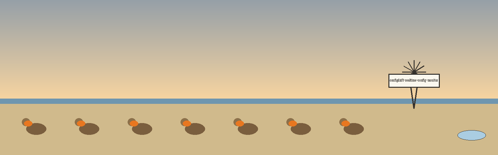
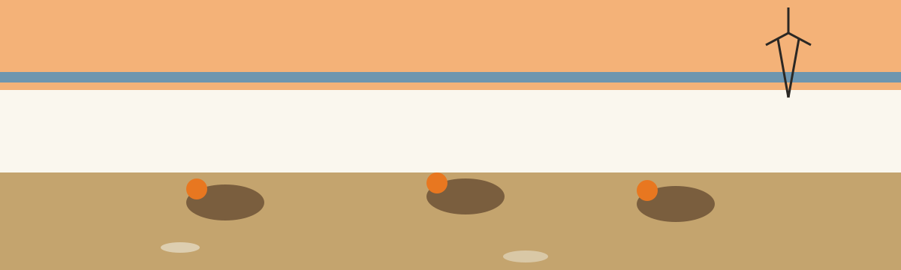

# configdrift-realtime-config-monitor

Theme: Prairie Chicken Booming Ground. Display face: MaidenOrange. Text face: Archivo.

# configdrift-realtime-config-monitor
A tool that monitors system configuration files in real-time and alerts on any unexpected changes, using file system events (e.g., via `watchdog`). - Focused on Detects unauthorized or unexpected changes to system configurations. Compares current configuration files against known good baselines and reports any deviations. A --version-control flag is accepted, but the version control integration is not implemented.

> **Checked Once Before the Watch Begins** Every watched file is checked once at startup before the observer starts.

## Install
`git clone https://github.com/ShadowStrikeHQ/configdrift-realtime-config-monitor`

> **Baselines Are YAML Whatever the Watched File Is Called** The baseline path is built from the paired name with a .yaml ending inside the baseline directory.

## Usage
`./configdrift-realtime-config-monitor [params]`

> **Version Control Flag** The flag --version-control is accepted, and its integration is stated in the code as not implemented.

## Parameters
- `-h`: Show help message and exit
- `-c`: No description provided
- `-n`: No description provided
- `-b`: No description provided
- `-i`: The time interval in seconds to check for changes.
- `--version-control`: No description provided
- `--debug`: Enable debug logging.

> **Half Written Files** A file written by an editor in several steps can be checked while it is still half written, because no settling delay is applied.

## License
Copyright (c) ShadowStrikeHQ

## Themed notes from the code

- The monitor watches named configuration files in real time through filesystem events supplied by watchdog.
- Every watched file is checked once at startup before the observer starts, so drift already present at launch is reported.
- A modification, a creation, a deletion, or a move touching a watched path sets off a fresh comparison.
- Each comparison loads the current file and its baseline through the YAML loader, whatever extension the watched file itself carries.
- The baseline path is built from the paired name with a .yaml ending inside the baseline directory.
- The two are compared with DeepDiff while ignoring order.
- Where a difference exists, a warning is logged carrying the drift and the file name.
- Where no difference exists, an information line says so.
- Where a watched file has been deleted or renamed away, a warning states that it is missing and no longer matches its baseline.
- No message is sent to any other channel, because the code provides none.
- Working form from the parser in main.py: python main.py is followed by the required file list, the required name list, and the required baseline directory.
- The parameter -h shows help and leaves.
- The parameter -c or --config-files takes one or more configuration files and is required.
- The parameter -n or --config-names takes one or more names in the same order as the files and is required, because each name decides which baseline file is opened.
- The parameter -b or --baseline-dir names the directory that holds the baselines and is required.
- The parameter -i or --interval gives an integer number of seconds with a default of 1.
- The flag --version-control is accepted, and its integration is stated in the code as not implemented.
- The flag --debug raises the logging level.
- Naming the same file twice under two names keeps only the last name when the lists are paired.
- A file written by an editor in several steps can be checked while it is still half written, because no settling delay is applied.
- Validation refuses a start, with exit 1, when the two lists differ in length, when the baseline directory does not exist, or when a watched file does not exist.
- A missing baseline file for one name is logged as an error for that check alone.
- The repository carries an MIT License file, while the README licence section prints only a copyright line in another organisation name.
- The README usage line is a placeholder and is kept as printed, with the parser form set beside it in the themed notes.

## Buttons and headings in this theme

- Button: Watch These Files
- Button: Open the Baseline Directory
- Button: Show the Full Row
- Heading: From the Outer Grass
- Heading: The Ring Itself
- Heading: The Windmill Row
- Heading: At the Stock Tank
